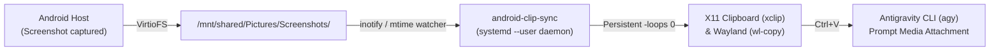

# android-clip-sync 📋⚡

> Seamless, sub-second Android screenshot & media clipboard sync for **AVF Debian** (Android 15 / 16 Virtualization Framework & Linux Terminal).
> Enables instant **Ctrl+V** image and media pasting in **Google Antigravity (`agy`)**, terminal emulators, and Wayland/X11 apps.

---

## 🎯 The Problem

Starting in Android 15 QPR2 and Android 16, Google introduced the native **Linux Terminal app** running Debian inside the **Android Virtualization Framework (AVF)**.

While text clipboard synchronization works out of the box via AVF's guest agent (`linux_vm_manager`), **rich media (screenshots, images, GIFs) is completely unsupported**:
1. When you take a screenshot on your Android phone, it lands on Android's internal storage (`/storage/emulated/0`), which is mapped into Debian via **VirtioFS** at `/mnt/shared/`.
2. However, the terminal session (`ttyd`) runs under `DISPLAY=:0` (Xwayland) without `WAYLAND_DISPLAY`, causing CLI tools like Antigravity (`agy`) to fall back to `xclip`.
3. Standard `xclip` in Linux terminates after serving **1 single selection request** (`-loops 1`). When `agy` queries `TARGETS` to check formats and then immediately attempts to read `image/png`, `xclip` is already dead, failing with:
   ```text
   Paste failed: exit status 1
   ```

---

## 🚀 The Solution: `android-clip-sync`

`android-clip-sync` bridges the gap:
* **Sub-second VirtioFS watcher**: Watches `/mnt/shared/Pictures/Screenshots` and drop directories for new screenshots and images.
* **Persistent `xclip -loops 0` daemon**: Spawns `xclip` with `-loops 0 -i`, keeping it alive indefinitely to serve `TARGETS` and full image payloads across repeated pastes.
* **Wayland & X11 dual-support**: Streams image data to both `wl-clipboard` (`wl-copy`) and `xclip`.
* **Zero friction**: Fully automated via a lightweight `systemd --user` background service. Take a screenshot on your phone, switch to your terminal, press **`Ctrl+V`**, and the image attaches immediately!



---

## 📦 Quick Install (One Command)

Inside your AVF Debian Terminal, run:

```bash
curl -fsSL https://raw.githubusercontent.com/kush-chou/android-clip-sync/main/install.sh | bash
```

*Or clone manually:*
```bash
git clone https://github.com/kush-chou/android-clip-sync.git
cd android-clip-sync
./install.sh
```

### What the Installer Does:
1. Installs minimal dependencies: `xclip`, `wl-clipboard`, `inotify-tools`, `python3`.
2. Verifies the `/mnt/shared` VirtioFS mount.
3. Installs `android-clip-sync` to `~/.local/bin/`.
4. Creates and activates the `systemd --user` service (`android-clip-sync.service`).
5. Configures `WAYLAND_DISPLAY`, `DISPLAY`, and aliases (`clip-latest`, `clip-paste`) in `~/.bashrc`.

---

## 🛠️ Usage & Commands

Once installed, everything is automatic in the background!

You also get manual CLI commands:

```bash
# Sync the most recent screenshot or media file on demand
clip-latest

# Or run directly
android-clip-sync latest

# Copy a specific image file to both clipboards
android-clip-sync /path/to/image.png

# Check status of the background watcher
systemctl --user status android-clip-sync.service

# View live sync logs
journalctl --user -u android-clip-sync.service -f
```

---

## 🔍 Verification & Diagnostics

To check your environment:
```bash
./install.sh --check
```

To test that `xclip` is correctly offering image targets:
```bash
export DISPLAY=:0
xclip -selection clipboard -t TARGETS -o
# Should output:
# TARGETS
# image/png
```

---

## 🧹 Uninstallation

To cleanly remove the service, binary, and configuration:
```bash
./install.sh --uninstall
```

---

## 📄 License

Apache License 2.0. Free to use, modify, and distribute.
